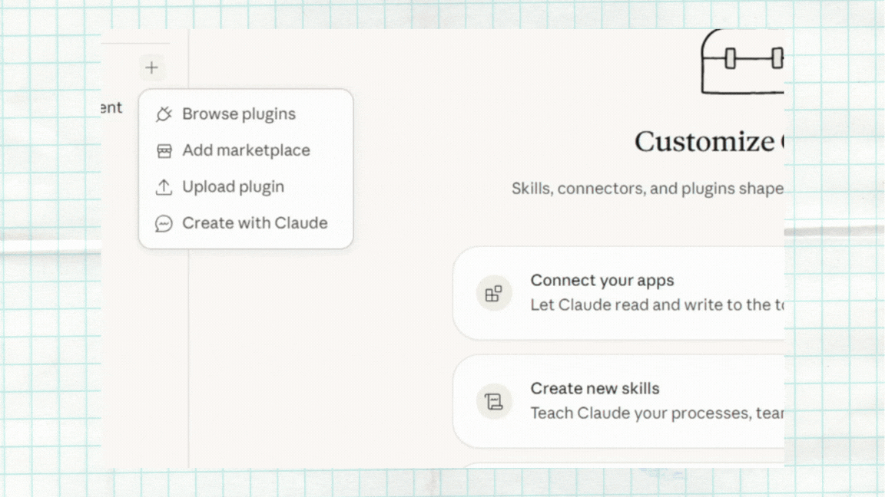
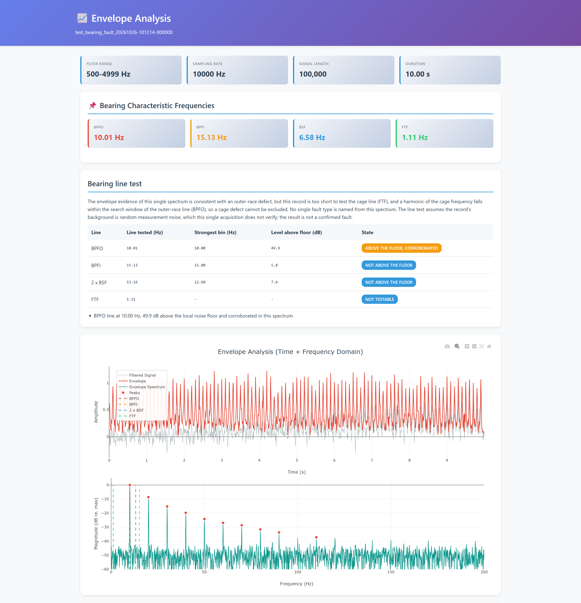
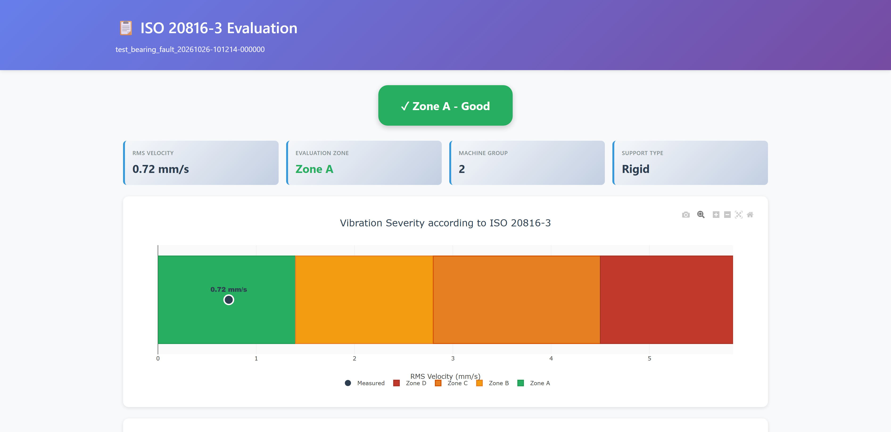

<p align="center">
  <picture>
    <source media="(prefers-color-scheme: dark)" srcset="https://raw.githubusercontent.com/LGDiMaggio/predictive-maintenance-mcp/main/assets/banner-dark.png">
    
  </picture>
</p>

# Predictive Maintenance MCP Server

<!-- mcp-name: io.github.LGDiMaggio/predictive-maintenance-mcp -->

[](https://www.python.org/downloads/)
[](https://doi.org/10.5281/zenodo.17611542)
[](https://github.com/LGDiMaggio/predictive-maintenance-mcp/actions/workflows/tests.yml)
[](https://codecov.io/gh/LGDiMaggio/predictive-maintenance-mcp)
[](https://opensource.org/licenses/MIT)
[](https://glama.ai/mcp/servers/LGDiMaggio/predictive-maintenance-mcp)

**Give your AI assistant evidence-based vibration diagnostics — machinery fault detection, ISO-cited severity, and diagnostic reports built to support and accelerate expert decision-making.**

An open-source [MCP](https://modelcontextprotocol.io/) server that turns LLMs into condition monitoring assistants for reliability engineers. Its core design rule: **the server refuses to guess**. No diagnosis is ever inferred from filenames or statistical parameters alone — a fault indication requires matching spectral evidence. Every severity claim cites ISO 20816-3, and the evaluative wording in reports is authored by the server, not improvised by the model. The AI orchestrates the analysis and presents the evidence — detected fault frequencies, matched fault patterns, severity zones — while the final judgment stays with the engineer. Also available as a **Claude Code plugin** with 8 diagnostic skills.

---

## Choose Your Path

| You are | Start here |
|---------|------------|
| **Reliability / maintenance engineer** — diagnostics in plain language, no coding | [Quick Start](#quick-start) below · then [Engineer's guide](docs/QUICKSTART_ENGINEER.md) for your own data, manuals and workflows |
| **AI / MCP developer** — run, integrate, and extend the server | [Developer's Quickstart](docs/QUICKSTART_DEVELOPER.md) · [Installation](INSTALL.md) |
| **Researcher / evaluator** — how the numbers are measured | [Benchmark Methodology](docs/benchmark-methodology.md) · [Benchmark](#benchmark) below |

---

## What Can It Do?

**Point the AI at a vibration signal → get the evidence behind the fault — detected frequencies, matched fault patterns, ISO-cited severity — to support your call.**

| You say | The AI does |
|---------|-------------|
| *"What does the vibration say about this bearing?"* | Loads the signal, tests each characteristic fault line against the noise floor of the envelope spectrum, reports what the evidence is consistent with and what it cannot exclude, cites the ISO 20816-3 severity zone |
| *"Generate a full diagnostic report"* | Produces an interactive HTML report with charts, fault markers, and server-authored severity wording |
| *"Extract specs from test_pump_manual.pdf and diagnose the signal"* | Reads the equipment manual, looks up the bearing model, calculates expected fault frequencies, tests each of them in the signal's envelope spectrum |
| *"Train an anomaly detector on my healthy baselines, then flag anomalies"* | Trains a model on your normal data, scores new signals, flags outliers for your review |
| *"What changed on pump P-101 since the baseline?"* | Reads the asset's recorded history, compares the latest acquisitions with the declared reference, and reports each indicator's change with the criterion it applied |

The AI doesn't guess: it calls **42 specialized MCP endpoints** (39 tools + 3 prompts) running locally on your machine. These counts describe the main branch; tools listed under Unreleased in the [CHANGELOG](CHANGELOG.md) are not yet in the published PyPI package. Every signal is referenced by a single `signal_id` handle from load to report. Your data never leaves your infrastructure.

Full endpoint reference, grouped by category: **[Tool Catalog](docs/TOOL_CATALOG.md)**.

---

## Quick Start

One route, from a fresh clone to a first diagnosis in Claude Desktop. You need [Git](https://git-scm.com/), [uv](https://docs.astral.sh/uv/getting-started/installation/) (it fetches Python 3.11 by itself) and [Claude Desktop](https://claude.ai/download).

**1. Clone the repository.** The 20 sample signals come with the clone, not with the PyPI package or with the source ZIP and tarball archives generated from this revision: real bearing measurements from the MathWorks rolling-element bearing dataset, healthy baselines plus inner and outer race faults, each with its companion metadata ([data/README.md](data/README.md)).

```bash
git clone https://github.com/LGDiMaggio/predictive-maintenance-mcp.git
cd predictive-maintenance-mcp
```

**2. Install and connect.** On Windows, one script creates the environment, installs the server and writes the Claude Desktop entry (clones inside OneDrive or other synced folders are handled):

```powershell
powershell -ExecutionPolicy Bypass -File setup_claude.ps1
```

<details>
<summary><b>macOS</b></summary>

```bash
uv venv .venv --python 3.11
uv pip install --python .venv/bin/python .
```

Add this entry to `~/Library/Application Support/Claude/claude_desktop_config.json`, with the absolute path of your clone in place of `/path/to/predictive-maintenance-mcp`. If a `predictive-maintenance` entry is already there, replace it:

```json
{
  "mcpServers": {
    "predictive-maintenance": {
      "command": "/path/to/predictive-maintenance-mcp/.venv/bin/python",
      "args": ["-m", "predictive_maintenance_mcp"],
      "env": { "PDM_PROJECT_DIR": "/path/to/predictive-maintenance-mcp" }
    }
  }
}
```

`PDM_PROJECT_DIR` tells the server where the sample signals and the reports live. Keep every path absolute: Claude Desktop launches servers with a minimal `PATH`.

</details>

**3. Restart and check.** Quit Claude Desktop completely (File, then Quit) and start it again. In a new chat ask:

> *"List the available vibration signals."*

The 20 included signals should appear. If they do not, see [INSTALL.md, Troubleshooting](INSTALL.md#troubleshooting).

**4. First diagnosis.** Try:

> *"Load real_train/OuterRaceFault_1.csv. The shaft runs at 1500 rpm: check the bearing against the fault frequencies declared in its metadata, assess the ISO severity and generate the envelope report."*

What comes back is the server's evidence, not the model's opinion: in the envelope spectrum the outer-race and inner-race lines both stand above the local noise floor, each with a further line of its own, so the evidence of this single spectrum is consistent with more than one fault type, and the check lists both with their levels without singling either out, while neither the ball nor the cage line stands above the floor; the ISO 20816-3 severity zone of the broadband velocity, with the machine group and support type the assessment assumed; and the path of an HTML report in `reports/` with those frequencies marked on the envelope spectrum. The call on the machine stays with you.

The file name carries the fault label, but the server never reads names. Ask which frequencies matched and with what deviation: the answer rests on the spectrum alone.

**Use your own data.** Put a single-column CSV without a header row where the server can read it (a folder of yours under `data/signals/`, or an absolute path), add a `<name>_metadata.json` next to it with `sampling_rate` and `signal_unit` (for example `"g"`), and ask for the analysis stating the shaft speed. Details and traps: [Use Your Own Data](docs/QUICKSTART_ENGINEER.md#use-your-own-data).

> **Other clients**: Claude Code, VS Code, Cursor and any other MCP client: [INSTALL.md, Manual Setup](INSTALL.md#manual-setup-windows--macos--linux).

---

## Benchmark

A blind, reproducible benchmark of the bearing check on the public
[CWRU Bearing Data Center](https://engineering.case.edu/bearingdatacenter)
dataset (12 kHz drive-end subset: 60 fault records + 4 normal baselines).
Fault labels never reach the system under test — signals enter under opaque
ids, a separate scorer is the only label reader, and blindness, checksum
integrity, and determinism are enforced by CI-run guard tests, not prose.
Results are stratified by the per-record diagnosability grades of the
Smith & Randall (2015) reference study, so records that study found
undiagnosable by any classical method are reported separately instead of
inflating or deflating the headline.

<!-- cwru-benchmark:start -->
On the records the reference study grades clearly diagnosable (Y1+Y2, <!-- slot: headline.n_records -->44<!-- /slot --> records), the line tested for the labelled fault stood above the local noise floor on <!-- slot: headline.frequency_detection.hits -->44<!-- /slot -->/<!-- slot: headline.frequency_detection.total -->44<!-- /slot -->, and the labelled fault was supported, with a further line of its own, on <!-- slot: headline.label_supported.count -->44<!-- /slot -->/<!-- slot: headline.label_supported.total -->44<!-- /slot -->.
Another fault type was supported as well on <!-- slot: headline.wrong_type_support.records -->44<!-- /slot -->/<!-- slot: headline.wrong_type_support.total -->44<!-- /slot -->; the check listed several types, the labelled one among them, on <!-- slot: headline.outcomes.several_types_with_label -->44<!-- /slot -->/<!-- slot: headline.outcomes.total -->44<!-- /slot --> and singled out no fault type on <!-- slot: headline.named_fault.none -->44<!-- /slot -->/<!-- slot: headline.named_fault.total -->44<!-- /slot -->.
The labelled fault was the first candidate listed, by level over the noise floor, on <!-- slot: headline.strongest_candidate.correct -->40<!-- /slot -->/<!-- slot: headline.strongest_candidate.total -->44<!-- /slot --> (<!-- slot: strata.Y1.strongest_candidate.correct -->9<!-- /slot -->/<!-- slot: strata.Y1.strongest_candidate.total -->9<!-- /slot --> on the textbook-signature Y1 stratum); that order is not a ranking of likelihood, and the check names no fault from it.
Of the <!-- slot: strata.ungraded.normals.total -->4<!-- /slot --> normal baselines, <!-- slot: strata.ungraded.normals.no_indication -->1<!-- /slot --> gave no indication and <!-- slot: strata.ungraded.normals.bearing_alert -->3<!-- /slot --> listed bearing candidates, <!-- slot: strata.ungraded.normals.named_fault -->1<!-- /slot --> of them singling out one fault type: counts on these recordings, not a specificity rate.
<!-- cwru-benchmark:end -->

The numbers above are read from the committed, re-runnable artifact
([results.json](benchmarks/cwru/results/results.json)) and drift-guarded by CI:
every value is bound to its key in the artifact, and a mismatch fails the build.
Methodology, blind protocol, and honest-benchmarking notes:
[docs/benchmark-methodology.md](docs/benchmark-methodology.md). Reproduce with:

```bash
python -m benchmarks.cwru all
```

---

## Claude Code Plugin

The project includes a **plugin for Claude Code** with domain-specific skills that activate automatically during conversation.

```shell
/plugin marketplace add LGDiMaggio/predictive-maintenance-mcp
/plugin install predictive-maintenance@predictive-maintenance-marketplace
```

<p align="center">
  
</p>

The plugin adds **8 skills** that activate automatically based on context (bearing-diagnosis, gear-diagnosis, quick-screening, report-generation, anomaly-detection, signal-management, documentation-search, prognostics), **2 agents** that run multi-step diagnostic workflows end-to-end and hand you the evidence (diagnostic-pipeline, signal-explorer), and **3 commands** for quick entry points (`/pm-diagnose`, `/pm-screen`, `/pm-report`).

Full skill, agent, and command reference: [Plugin README](plugin/README.md).

---

## Reports

All analysis tools generate **interactive HTML reports** you can open in any browser — pan, zoom, hover for details. Also supports structured Word (.docx) exports.

<details>
<summary><b>Report examples</b></summary>





*Both examples were generated from a synthetic test signal with the `generate_test_signal` tool. They show what the reports contain; the Zone A result does not describe a real machine.*

| Report Type | What it shows |
|-------------|---------------|
| Frequency spectrum | Peak detection, harmonic markers |
| Envelope analysis | Bearing fault frequency matching |
| Severity assessment | Vibration health zones (ISO 20816-3) |
| Word document | Full diagnostic narrative with embedded charts |
| PCA visualization | Multi-signal anomaly clustering |
| Feature comparison | Side-by-side signal feature analysis |

</details>

---

## Asset Health Ledger

A single diagnosis answers "what does this signal show". The asset health ledger answers "what changed on this machine since the reference": every measurement loaded with a declared identity (asset, measurement point, acquisition instant, operating conditions) is recorded in a local append-only ledger with its derived indicators, compared with the healthy baseline the engineer declares, and judged against the reference band with the rule it applied stated in the result. Four tools carry the workflow: `declare_measurement_point`, `declare_healthy_baseline`, `get_asset_history` and `assess_asset_change`. Contract and operations: [Adapter Guide](docs/ADAPTER_GUIDE.md#declaring-a-measurement) · worked flow: [Examples](EXAMPLES.md#example-8-asset-history) · reference adapter: [STWIN.box](examples/adapters/stwinbox/README.md).

---

## Architecture

```
          YOU (natural language)
               │
               v
     LLM (Claude, GPT, Ollama...)
     understands intent, selects tools
               │
               v  ── Model Context Protocol ──
    ┌──────────────────────────────┐
    │    Predictive Maintenance    │
    │         MCP Server           │
    │                              │
    │  Signal Analysis    Reports  │
    │  Fault Detection    ML       │
    │  Severity Rating    RAG Docs │
    └──────────────────────────────┘
               │
               v
       YOUR DATA (stays local)
    signals · manuals · models
```

The codebase follows a **modular architecture** organized around the ISO 13374 Six-Block Diagnostic standard — signal acquisition, processing, diagnostics, prognostics, and decision support as separate sub-packages. Standards implemented: ISO 13374, ISO 20816-3, MIMOSA OSA-CBM. Module-level detail: [Architecture guide](docs/architecture.md).

**Key design choices:**
- **Privacy-first** — raw vibration data never leaves your machine; only computed results flow to the LLM
- **LLM-agnostic** — works with Claude, ChatGPT, Microsoft Copilot Studio, or any MCP-compatible client. Use [Ollama](docs/OLLAMA_GUIDE.md) for fully air-gapped deployments
- **Modular** — use only the tools you need, extend with your own

---

## Documentation

| Guide | For |
|-------|-----|
| [Engineer's guide](docs/QUICKSTART_ENGINEER.md) | After the first diagnosis: your own data, machine manuals, workflows |
| [Quickstart for Developers](docs/QUICKSTART_DEVELOPER.md) | Understand MCP, extend the server |
| [Tool Catalog](docs/TOOL_CATALOG.md) | Every MCP endpoint, grouped by category |
| [Adapter Guide](docs/ADAPTER_GUIDE.md) | Bring vendor/DAQ raw data in via explicit declarations |
| [Plugin README](plugin/README.md) | Claude Code plugin installation and usage |
| [HTTPS Deployment](docs/DEPLOYMENT.md) | Docker + HTTPS for enterprise environments |
| [Ollama Guide](docs/OLLAMA_GUIDE.md) | Use with local LLMs (fully air-gapped) |
| [Architecture](docs/architecture.md) | ISO 13374 block mapping and module design |
| [Benchmark Methodology](docs/benchmark-methodology.md) | How the CWRU diagnostic benchmark is measured |
| [Examples](EXAMPLES.md) | Complete diagnostic workflows |
| [Installation](INSTALL.md) | Detailed setup and troubleshooting |
| [Contributing](CONTRIBUTING.md) | How to contribute (all skill levels welcome) |
| [Changelog](CHANGELOG.md) | Version history |

---

## Testing

**85%+ test coverage**, enforced as a CI minimum, across Windows, macOS, and Linux (Python 3.11 & 3.12) — the current measured figure is on the codecov badge above.

```bash
pytest                                  # run all tests
pytest --cov=src --cov-report=html      # with coverage report
```

20+ test files covering signal analysis, fault detection, severity assessment, ML models, report generation, RAG search, and real bearing fault data validation.

---

## Roadmap

- [x] 42 MCP endpoints on the main branch (39 tools, 3 prompts) with modular architecture and a single `signal_id` handle
- [x] Claude Code plugin (8 skills, 2 agents, 3 commands)
- [x] 85%+ test coverage enforced in CI, CI/CD on 3 platforms
- [x] Docker + SSE/HTTP transport for enterprise deployment
- [x] Semantic document search (FAISS + TF-IDF)
- [x] Blind, reproducible diagnostic benchmark on the CWRU dataset (extensible to Paderborn)
- [ ] Customizable severity thresholds
- [x] Remaining useful life (RUL) estimation from repeated measurements (linear, exponential, Kalman)
- [x] Trend analysis and degradation onset detection
- [x] Asset health ledger: per-asset measurement history with a declared reference and qualified comparability
- [ ] Multi-signal trending and historical comparison
- [ ] Real-time streaming (MQTT/Kafka)
- [ ] Fleet dashboard for multi-asset monitoring
- [ ] CMMS integration (SAP, Maximo, Infor)

> Ideas? [Open a discussion](https://github.com/LGDiMaggio/predictive-maintenance-mcp/discussions) or [create an issue](https://github.com/LGDiMaggio/predictive-maintenance-mcp/issues/new/choose).

---

## Are you using this?

I'd genuinely love to know. Whether you ran it on real machinery or just tried the sample data, drop a line in [Discussions](https://github.com/LGDiMaggio/predictive-maintenance-mcp/discussions) — one sentence about your machine or use case is enough. Real-world feedback directly shapes what gets built next.

---

## Related

**[claude-stwinbox-diagnostics](https://github.com/LGDiMaggio/claude-stwinbox-diagnostics)** — Extends this project by connecting a physical edge sensor (STEVAL-STWINBX1) to Claude via MCP, with Claude Skills for guided condition monitoring. Same analysis engine, real hardware, operator-friendly reports.

---

## Contributing

Contributions welcome from **everyone** — not just programmers. Domain experts, technical writers, and testers are equally valued. See [CONTRIBUTING.md](CONTRIBUTING.md) for paths tailored to your background.

**Quick start**: browse [Issues](https://github.com/LGDiMaggio/predictive-maintenance-mcp/issues) for `good first issue` or `help wanted` labels.

---

## Citation

```bibtex
@software{dimaggio_predictive_maintenance_mcp_2025,
  title   = {Predictive Maintenance MCP Server},
  author  = {Di Maggio, Luigi Gianpio},
  year    = {2025},
  version = {0.13.0},
  url     = {https://github.com/LGDiMaggio/predictive-maintenance-mcp},
  doi     = {10.5281/zenodo.17611542}
}
```

## License

MIT, see [LICENSE](LICENSE). The sample data in `data/` is licensed separately under CC BY-NC-SA 4.0 (non-commercial); its attribution and terms are in [data/LICENSE](data/LICENSE). For commercial use, replace it with your own machinery data.

## Acknowledgments

[MCP Python SDK](https://github.com/modelcontextprotocol/python-sdk) (descended from [FastMCP](https://github.com/jlowin/fastmcp)) · [Model Context Protocol](https://modelcontextprotocol.io/) by Anthropic · Sample data by Eric Bechhoefer, redistributed by [MathWorks](https://github.com/mathworks/RollingElementBearingFaultDiagnosis-Data) · Core development assisted by [Claude](https://claude.ai)

---

*An open-source predictive maintenance AI agent and condition monitoring copilot — built to support reliability engineers and the developer community.*
